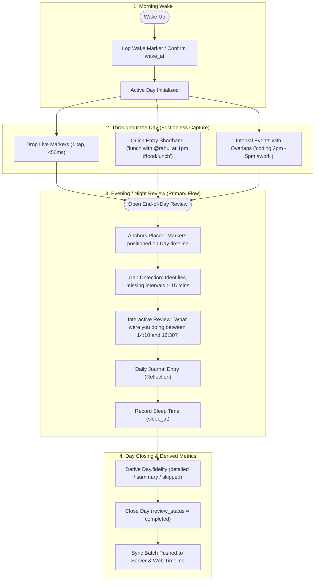
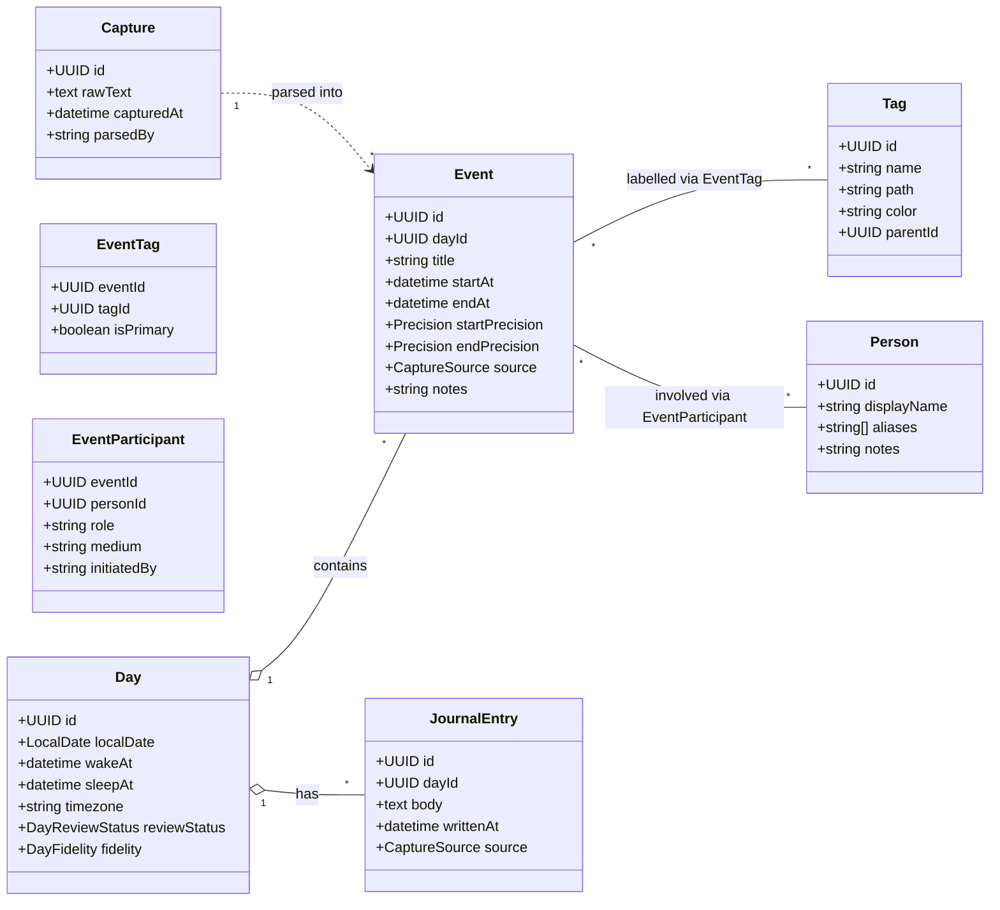
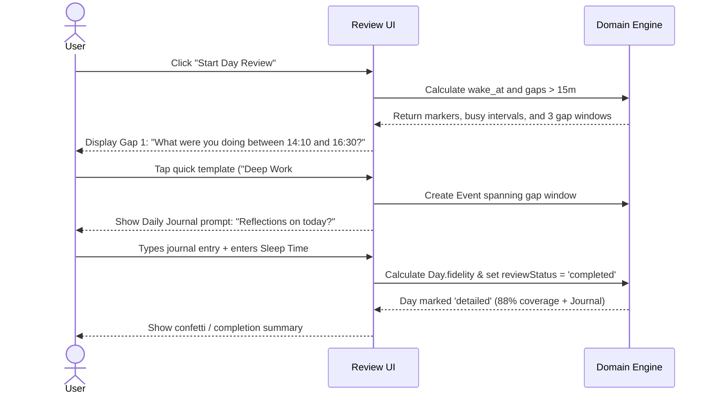

# Step 2: The Daily Loop — Detailed Implementation Specification

> **Parent Documents:**
> - [life-logger-high-level-design(2).md](./life-logger-high-level-design%282%29.md)
> - [Life Logger Implementation Plan.md](./Life%20Logger%20Implementation%20Plan.md)
> - Task mirror: [tasks/step-2-daily-loop.md](./tasks/step-2-daily-loop.md)
> - Completed Milestone: [Step 1 - Walking Skeleton.md](./Step%201%20-%20Walking%20Skeleton.md) | [`docs/reports/increment-1-completion-report.md`](./docs/reports/increment-1-completion-report.md)
>
> **Goal:** A normal day can be logged, captured via quick-entry shorthand, and reviewed entirely across the Android and Web apps, working completely offline and syncing seamlessly.
>
> **Estimated Effort:** ~15 focused engineering days.

---

## 1. Executive Summary & The Daily Loop Lifecycle

While **Increment 1** delivered the thin walking skeleton (one marker offline $\rightarrow$ sync $\rightarrow$ web list), **Increment 2** establishes the core product: logging, structuring, and reviewing real days.

The "Daily Loop" follows a natural 24-hour human rhythm:



---

## 2. Core Decisions Confirmed for Increment 2

| Decision # | Area | Specification | Rationale |
|---|---|---|---|
| **Decision 4** | **Tag Tree** | Single unified hierarchical tag tree (`path` like `work/coding`, `food/lunch`) with a `is_primary` flag on the event-tag link. | Replaces separate "category" vs "tag" concepts. Every event has exactly one primary tag for daily rollups and zero or more secondary tags. |
| **Decision 5** | **Context Observations** | State-of-mind observations are generic `(dimension, value, time, subject)` rows. | Adding new dimensions (valence, arousal, energy) requires no table schema alteration. |
| **Decision 11**| **Derived Fidelity** | `Day.fidelity` (`detailed`, `summary`, `skipped`) is **algorithmically derived**, never asked. | Derived from waking hours timeline coverage ($\ge 75\%$ for `detailed`, $\ge 30\%$ for `summary`) plus journal presence. Eliminates user survey fatigue. |
| **Decision 16**| **Rule-Based Parser** | Shorthand text parsing is 100% deterministic rule-based (regex/token matching). | Zero dependency on cloud APIs or local LLMs. Fast ($<5\text{ms}$ on mobile). Unparsed text stays as title and is never hallucinated. |

---

## 3. Domain Model v1 (`packages/domain`) (Work Packages 2.1 – 2.6)

Building upon the initial skeleton, the domain model expands to support intervals, tags, people, and quick-entry parsing:



### 3.1 TypeScript Entity Additions
```typescript
// packages/domain/src/types.ts

export interface Tag extends EntityMetadata {
  name: string;
  path: string; // e.g. "work/coding" or "hygiene/brush"
  color?: string;
  parentId?: UUID;
}

export interface EventTag {
  eventId: UUID;
  tagId: UUID;
  isPrimary: boolean;
}

export type ParticipantMedium = 'in_person' | 'call' | 'text' | 'video' | 'online';
export type ParticipantInitiation = 'me' | 'them' | 'mutual';

export interface Person extends EntityMetadata {
  displayName: string;
  aliases: string[];
  notes?: string;
}

export interface EventParticipant {
  eventId: UUID;
  personId: UUID;
  role: string; // default "with"
  medium: ParticipantMedium;
  initiatedBy: ParticipantInitiation;
}

export interface JournalEntry extends EntityMetadata {
  dayId: UUID;
  body: string;
  writtenAt: ISODateTimeString;
  source: CaptureSource;
}

export interface Capture extends EntityMetadata {
  rawText: string;
  capturedAt: ISODateTimeString;
  parsedBy: string; // e.g. "rule-parser-v0"
}
```

---

## 4. Derived Logic & Algorithms (`packages/domain`)

### 4.1 Timeline Overlap & Lane Assignment Algorithm (WP 2.2, 2.7)
Events may overlap arbitrarily (e.g. "listening to podcast" while "commuting"). Overlaps are never stored; they are **derived**:

```typescript
export interface VisualTimelineEvent {
  event: Event;
  laneIndex: number;
  totalLanes: number;
}

/**
 * Assigns visual layout lanes to a set of interval events for multi-lane timeline rendering.
 * Uses interval graph coloring (greedy interval scheduling).
 */
export function computeTimelineLanes(events: Event[]): VisualTimelineEvent[] {
  // 1. Sort events by startAt ASC, then duration DESC
  // 2. Track end-times of active lanes
  // 3. Assign each event to the first lane whose last event has ended
  // 4. Return event with laneIndex and total overlapping lanes count
}
```

### 4.2 Gap Detection Algorithm (WP 2.7, 2.8)
```typescript
export interface TimelineGap {
  startAt: ISODateTimeString;
  endAt: ISODateTimeString;
  durationMinutes: number;
}

/**
 * Computes unlogged gaps between wake_at and sleep_at (or current time if awake).
 * Only surfaces gaps longer than minGapMinutes (default: 15 mins).
 */
export function findTimelineGaps(
  day: Day,
  events: Event[],
  minGapMinutes: number = 15,
  currentTime: Date = new Date()
): TimelineGap[] {
  // Bounds: day.wakeAt to (day.sleepAt ?? currentTime)
  // Flattens overlapping event intervals into unified busy intervals
  // Returns inverse unlogged intervals where duration >= minGapMinutes
}
```

### 4.3 Derived Day Fidelity Algorithm (WP 2.1)
```typescript
/**
 * Calculates Day fidelity deterministically:
 * - 'detailed': >= 75% waking hours logged with events AND journal entry present
 * - 'summary': >= 30% waking hours logged OR journal entry present
 * - 'skipped': < 30% waking hours logged and no journal entry
 */
export function calculateDayFidelity(
  day: Day,
  events: Event[],
  journalEntries: JournalEntry[]
): DayFidelity {
  if (!day.wakeAt) return 'skipped';
  
  const wake = new Date(day.wakeAt).getTime();
  const sleep = day.sleepAt ? new Date(day.sleepAt).getTime() : new Date().getTime();
  const wakingDurationMs = Math.max(0, sleep - wake);
  if (wakingDurationMs === 0) return 'skipped';

  // Calculate non-overlapping covered duration
  const coveredMs = calculateUnionDuration(events);
  const coverageRatio = coveredMs / wakingDurationMs;
  const hasJournal = journalEntries.length > 0 && journalEntries.some(j => j.body.trim().length > 0);

  if (coverageRatio >= 0.75 && hasJournal) return 'detailed';
  if (coverageRatio >= 0.30 || hasJournal) return 'summary';
  return 'skipped';
}
```

---

## 5. Quick-Entry Rule Parser v0 Specification (WP 2.5)

The quick-entry parser accepts a single string of free text and deterministically extracts time, title, tags, and people.

### 5.1 Grammar & Syntax Rules
| Token Type | Syntax | Examples | Output Behavior |
|---|---|---|---|
| **Tags** | `#<tag-path>` | `#work`, `#food/lunch`, `#reading` | Extracted into `tagPaths[]`. First tag becomes `primaryTag`. |
| **People** | `@<name>` | `@rahul`, `@sarah`, `@mom` | Extracted into `peopleNames[]`. Matches existing Person by alias/name, or marks for creation. |
| **Point Time** | `at <time>` or `<time>` | `at 2`, `at 14:30`, `2pm`, `9:15am` | Sets `startAt` to today at that time; sets `startPrecision = 'exact'`. |
| **Interval Time** | `<time> to <time>`, `<time>-<time>` | `2pm to 4pm`, `10:00-11:30` | Sets `startAt` and `endAt`. |
| **Duration** | `for <duration>` | `for 45m`, `for 1.5h`, `for 2 hours` | Computes `endAt = startAt + duration`. |
| **Title** | Remaining unparsed text | `"lunch with"`, `"coded backend"` | Stripped of tag/people/time tokens. **Never discarded.** |

### 5.2 Parser Invariants
1. **Never Hallucinate:** If a time string cannot be parsed unambiguously, it remains in the title and `startAt` defaults to `now`.
2. **Preserve Raw Input:** Every quick-entry save writes a `Capture` record with `raw_text`. If the parser improves in future versions, past captures can be re-parsed.
3. **Speed:** Pure in-memory regex tokenizer running in $< 2\text{ms}$.

---

## 6. Persistence Schema Migration (`packages/persistence`) (WP 2.3, 2.9)

### Migration 2 DDL: Schema Expansion (`packages/persistence/src/sqlite/migrations.ts`)

```sql
-- Migration 2: Daily Loop Entities
CREATE TABLE IF NOT EXISTS tags (
  id TEXT PRIMARY KEY,
  name TEXT NOT NULL,
  path TEXT NOT NULL UNIQUE,
  color TEXT,
  parent_id TEXT REFERENCES tags(id) ON DELETE CASCADE,
  created_at TEXT NOT NULL,
  updated_at TEXT NOT NULL,
  is_deleted INTEGER NOT NULL DEFAULT 0
);

CREATE TABLE IF NOT EXISTS events (
  id TEXT PRIMARY KEY,
  day_id TEXT NOT NULL REFERENCES days(id) ON DELETE CASCADE,
  title TEXT NOT NULL,
  start_at TEXT NOT NULL,
  end_at TEXT,
  start_precision TEXT NOT NULL DEFAULT 'exact',
  end_precision TEXT NOT NULL DEFAULT 'exact',
  source TEXT NOT NULL DEFAULT 'live',
  notes TEXT,
  created_at TEXT NOT NULL,
  updated_at TEXT NOT NULL,
  is_deleted INTEGER NOT NULL DEFAULT 0
);

CREATE TABLE IF NOT EXISTS event_tags (
  event_id TEXT NOT NULL REFERENCES events(id) ON DELETE CASCADE,
  tag_id TEXT NOT NULL REFERENCES tags(id) ON DELETE CASCADE,
  is_primary INTEGER NOT NULL DEFAULT 0,
  PRIMARY KEY (event_id, tag_id)
);

CREATE TABLE IF NOT EXISTS people (
  id TEXT PRIMARY KEY,
  display_name TEXT NOT NULL,
  aliases_json TEXT NOT NULL DEFAULT '[]',
  notes TEXT,
  created_at TEXT NOT NULL,
  updated_at TEXT NOT NULL,
  is_deleted INTEGER NOT NULL DEFAULT 0
);

CREATE TABLE IF NOT EXISTS event_participants (
  event_id TEXT NOT NULL REFERENCES events(id) ON DELETE CASCADE,
  person_id TEXT NOT NULL REFERENCES people(id) ON DELETE CASCADE,
  role TEXT NOT NULL DEFAULT 'with',
  medium TEXT NOT NULL DEFAULT 'in_person',
  initiated_by TEXT NOT NULL DEFAULT 'mutual',
  PRIMARY KEY (event_id, person_id)
);

CREATE TABLE IF NOT EXISTS journal_entries (
  id TEXT PRIMARY KEY,
  day_id TEXT NOT NULL REFERENCES days(id) ON DELETE CASCADE,
  body TEXT NOT NULL,
  written_at TEXT NOT NULL,
  source TEXT NOT NULL DEFAULT 'live',
  created_at TEXT NOT NULL,
  updated_at TEXT NOT NULL,
  is_deleted INTEGER NOT NULL DEFAULT 0
);

CREATE TABLE IF NOT EXISTS captures (
  id TEXT PRIMARY KEY,
  raw_text TEXT NOT NULL,
  captured_at TEXT NOT NULL,
  parsed_by TEXT NOT NULL DEFAULT 'rule-parser-v0',
  created_at TEXT NOT NULL,
  updated_at TEXT NOT NULL,
  is_deleted INTEGER NOT NULL DEFAULT 0
);

CREATE INDEX IF NOT EXISTS idx_events_day_id ON events(day_id);
CREATE INDEX IF NOT EXISTS idx_events_start_at ON events(start_at);
CREATE INDEX IF NOT EXISTS idx_events_updated_at ON events(updated_at);
CREATE INDEX IF NOT EXISTS idx_tags_path ON tags(path);
CREATE INDEX IF NOT EXISTS idx_journal_day_id ON journal_entries(day_id);
```

### 6.1 Repository Interfaces Added
- [`IEventRepository`](./packages/persistence/src/interfaces.ts): `save()`, `saveBatch()`, `findById()`, `listByDay()`, `listModifiedSince()`.
- [`ITagRepository`](./packages/persistence/src/interfaces.ts): `save()`, `findByPath()`, `listTree()`, `assignTagsToEvent()`.
- [`IPersonRepository`](./packages/persistence/src/interfaces.ts): `save()`, `findByNameOrAlias()`, `listAll()`, `linkParticipant()`.
- [`IJournalRepository`](./packages/persistence/src/interfaces.ts): `save()`, `listByDay()`.

---

## 7. Sync Protocol Expansion (`packages/sync`) (WP 2.9)

The sync protocol wire formats now handle all Daily Loop record types:

```typescript
export type EntitySyncType = 
  | 'marker' 
  | 'day' 
  | 'event' 
  | 'tag' 
  | 'event_tag' 
  | 'person' 
  | 'event_participant' 
  | 'journal_entry' 
  | 'capture';
```

### Ingestion Invariants
1. **Foreign Key Safety:** Incoming `event` records referencing unknown `dayId` automatically instantiate the parent Day record.
2. **Associative Entity Sync:** `event_tags` and `event_participants` are synced alongside events in the same atomic transaction batch.
3. **Soft-Delete Propagation:** Soft-deleted events cascade soft-deletion down to their tag and participant links without physical database deletion.

---

## 8. User Experience & Flows (Android & Web)

### 8.1 Android Capture Screen Updates (WP 2.5, 2.7)
- **Top Quick-Entry Box:**
  - Auto-expands on focus with inline completion for `#tags` and `@people`.
  - Hitting `Enter` logs the event in $< 50\text{ms}$ locally and enqueues to outbox.
- **Large Marker Button:** Kept prominently at bottom for rapid 1-tap timestamp drops.
- **Mini Day Timeline Widget:**
  - Shows current day's progress bar with filled intervals and unlogged gaps.

### 8.2 End-of-Day Review Screen (Web & Android) (WP 2.8)
An interactive 5-minute evening review modal:



---

## 9. Work Packages & 15-Day Implementation Schedule

| Day | WP | Work Package Name | Key Deliverables & Code Artifacts |
|---|---|---|---|
| **Days 1–2** | **WP 2.1** | Day Lifecycle & Fidelity | `Day` wake/sleep triggers, state transitions, unit tests for `calculateDayFidelity`. |
| **Days 3–4** | **WP 2.2** | Events with Precision | `Event` entity, precision validators, `computeTimelineLanes` algorithm and tests. |
| **Days 5–6** | **WP 2.3** | Tag Hierarchy | Migration 2 schema, `Tag` tree model, `ITagRepository`, primary tag assignment. |
| **Day 7** | **WP 2.4** | People & Participants | `Person` and `EventParticipant` models, `IPersonRepository`, alias resolution. |
| **Days 8–9** | **WP 2.5** | Quick-Entry Rule Parser v0 | Regex/tokenizer engine in `packages/domain`, extensive unit tests across 30+ sentence forms. |
| **Day 10** | **WP 2.6** | Journal Entries | `JournalEntry` entity, `IJournalRepository`, markdown text storage. |
| **Days 11–12**| **WP 2.7** | Timeline & Gap Engine | Multi-lane timeline UI in React Web and Android; gap detection algorithm (`findTimelineGaps`). |
| **Days 13–14**| **WP 2.8** | End-of-Day Review Flow | Interactive gap review wizard, sleep logging, offline support on Android. |
| **Day 15** | **WP 2.9** | Sync & Dogfooding Verification | Full sync test suite across all 6 new entities; initial self-dogfooding run. |

---

## 10. Quality Gates & Definition of Done for Increment 2

Increment 2 is complete when:
1. **Dogfooding Milestone:** You can run and use the system yourself every day for **14 consecutive days** using both the phone and PC.
2. **Performance Budgets Maintained:**
   - Phone Quick-Entry save latency: $< 50\text{ ms}$.
   - Phone Marker save latency: $< 50\text{ ms}$ (baseline maintained from Increment 1).
   - Timeline multi-lane render: $< 30\text{ ms}$ for a 50-event day.
3. **Parser Reliability:** Parser never crashes on invalid syntax and achieves 100% test pass rate across all test suite sentence patterns.
4. **All Tests Green:** Unit, contract, and sync tests pass in CI with zero warnings.
5. **Release Tagged:** Git release tag `v0.2.0-increment-2` created.
