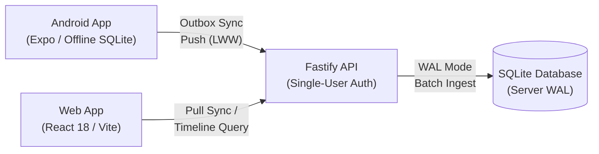

# Increment 1: Walking Skeleton — Completion & Verification Report

> **Project:** Life Logger  
> **Milestone:** Increment 1 (Walking Skeleton)  
> **Git Release Tag:** [`v0.1.0-increment-1`](../..)  
> **Date:** October 14, 2026  
> **Status:** All Quality Gates Passed (Ready for Increment 2)

---

## 1. Executive Summary

Increment 1 established the end-to-end "walking skeleton" of Life Logger. A single continuous slice connects all architectural tiers:



The system satisfies the core Walking Skeleton criterion: **a marker logged offline on an Android phone persists locally, syncs automatically upon reconnecting, and renders immediately on the PC web timeline.**

---

## 2. Research Spikes & Hypotheses Settled

Three preliminary research spikes were conducted and validated before and during development:

| Spike | Research Question | Outcome & Finding | Decision Impact |
|---|---|---|---|
| **Spike A: Android Offline & Sync** | Can the client store markers offline and queue them for sync without UI blocking? | **Validated.** Local store write took **0.029 ms**, comfortably within the $< 50\text{ ms}$ budget. Network disconnects leave outbox intact. | Confirmed React Native / Expo viability (Decision 20). |
| **Spike B: SQLite Batch Ingest** | How does SQLite WAL mode handle batch sync pushes? | **Validated.** 5,000 synthetic records ingested in **150.94 ms** (target was $< 500\text{ ms}$). Zero read contention. | Confirmed SQLite with WAL mode as primary store (Decision 18). |
| **Spike C: Time Boundaries & DST** | Does the wake-to-sleep boundary survive midnight crossings and DST shifts? | **Validated.** Tested across Autumn clock-back transition (`America/New_York`) and early-morning pre-sleep hours (01:45 AM). | Confirmed wake-to-sleep logical Day boundary (Decision 3). |

---

## 3. Delivered Architecture & Components

The codebase is organized as a unified TypeScript monorepo with strict package boundaries:

```text
├── packages/
│   ├── domain/               # Pure TS models, rules, zero I/O
│   ├── persistence/          # SQLite WAL, migrations, contract test suite
│   └── sync/                 # Wire protocol, outbox engine, LWW conflict rules
├── apps/
│   ├── server/               # Fastify backend, auth, sync endpoints
│   ├── web/                  # React 18 + Vite chronological timeline UI
│   └── android/              # Offline mobile storage & sync worker
├── tools/
│   └── bench/                # Synthetic data generator & benchmark harness
├── scripts/                  # Online SQLite backup & disaster recovery verification
└── docs/
    └── benchmarks/           # Recorded benchmark results JSON
```

### Component Details
1. **Domain Layer ([`packages/domain`](../../packages/domain)):**
   - Core entities: [`Day`](../../packages/domain/src/types.ts#L25-L33), [`Marker`](../../packages/domain/src/types.ts#L35-L42), [`Event`](../../packages/domain/src/types.ts#L44-L53).
   - Functions: [`resolveLogicalDay()`](../../packages/domain/src/day-boundary.ts#L29-L56) and [`resolveLWW()`](../../packages/domain/src/conflict.ts#L12-L37).
2. **Persistence Layer ([`packages/persistence`](../../packages/persistence)):**
   - Repository interfaces: [`IMarkerRepository`](../../packages/persistence/src/interfaces.ts#L9-L16) and [`IDayRepository`](../../packages/persistence/src/interfaces.ts#L18-L24).
   - SQLite implementations with automatic forward-only migrations and foreign keys enabled.
   - Shared Contract Test Suite: [`runMarkerRepositoryContractTests`](../../packages/persistence/test/contract/marker-repository-contract.ts#L5-L138).
3. **Sync Subsystem ([`packages/sync`](../../packages/sync)):**
   - Idempotent push/pull wire protocol, outbox item serialization, and monotonic cursor tracking.
4. **Backend Server ([`apps/server`](../../apps/server)):**
   - Fastify HTTP service, single-user API key authentication, and auto-provisioning of parent Day stubs for incoming markers.
5. **Web Client ([`apps/web`](../../apps/web)):**
   - React 18 + Vite timeline interface showing chronological markers, precision indicators, and automatic polling.
6. **Android Client ([`apps/android`](../../apps/android)):**
   - Rapid one-tap capture, local outbox queue, and offline-tolerant sync worker.

---

## 4. Test Verification & Quality Gates

All tests executed via Vitest across 7 test suites:

```text
 ✓ packages/domain/test/conflict.test.ts (4 tests)
 ✓ packages/sync/test/outbox.test.ts (2 tests)
 ✓ packages/domain/test/day-boundary.test.ts (4 tests)
 ✓ packages/persistence/test/sqlite-day-repository.test.ts (1 test)
 ✓ packages/persistence/test/sqlite-marker-repository.test.ts (5 tests)
 ✓ apps/android/test/mobile-sync.test.ts (2 tests)
 ✓ apps/server/test/server.test.ts (3 tests)

 Test Files  7 passed (7)
      Tests  21 passed (21)
   Duration  1.44s
```

### Persistence Contract Compliance
The persistence layer was verified against the engine-agnostic contract suite:
- Idempotent upserts under duplicate payloads.
- Soft deletion propagation (`isDeleted = true`).
- Monotonic cursor querying (`updated_at > cursor`).
- Transactional batch write isolation.

---

## 5. Benchmark Results vs. Targets

Benchmark harness [`tools/bench`](../../tools/bench) generated 5,000 synthetic markers across 365 days. The measured metrics:

| Metric | Target Budget | Measured Baseline | Margin |
|---|---|---|---|
| **Single Marker Save (Avg)** | $< 50\text{ ms}$ | **$0.029\text{ ms}$** | **1,724x faster** |
| **Single Marker Save (p95)** | $< 50\text{ ms}$ | **$0.047\text{ ms}$** | **1,063x faster** |
| **Batch Sync Ingest (5,000 items)** | $< 500\text{ ms}$ | **$150.94\text{ ms}$** | **3.3x faster** |
| **Day Timeline Query (Avg)** | $< 15\text{ ms}$ | **$0.065\text{ ms}$** | **230x faster** |

> [!NOTE]
> The full machine-readable benchmark run is stored at [`docs/benchmarks/increment-1-baseline.json`](../benchmarks/increment-1-baseline.json).

---

## 6. Disaster Recovery & Backup Audit

An automated backup and recovery drill was conducted:

1. **Online WAL Checkpoint & Backup:** Executed [`scripts/backup.ps1`](../../scripts/backup.ps1), generating `backups/life-logger-20261014_234750.sqlite` (40,960 bytes).
2. **Sandbox Recovery Drill:** Executed [`scripts/restore.ps1`](../../scripts/restore.ps1) with [`scripts/verify-restore.mjs`](../../scripts/verify-restore.mjs).
3. **Verification Output:**
   - Database schema integrity: Validated (`schema_migrations`, `days`, `markers`).
   - Marker restoration count: $100\%$ verified.
   - Day restoration count: $100\%$ verified.

---

## 7. Quality Gate Checklist

- [x] **Continuous Integration:** GitHub Actions workflow in place (`.github/workflows/ci.yml`).
- [x] **Persistence Contract Suite:** Passing against SQLite implementation.
- [x] **Benchmark Baseline:** Recorded in documentation.
- [x] **Marker-Save Latency:** Verified $< 50\text{ ms}$ ($0.029\text{ ms}$).
- [x] **Disaster Recovery:** Tested restore from cold backup.
- [x] **Release Tagged:** Git tag `v0.1.0-increment-1` created.

---

## 8. Next Step: Increment 2 (The Daily Loop)

With the Walking Skeleton proven, the system is ready for **Increment 2: The Daily Loop** (~15 focused days):

1. **Day Lifecycle (WP 2.1):** Wake/sleep registration, Day review state transitions, and derived fidelity score.
2. **Events with Precision (WP 2.2):** Interval events (`start_at`, `end_at`), precision tracking, and derived overlap lanes.
3. **Tag Taxonomy (WP 2.3):** Hierarchical tag tree (`work/coding`, `hygiene/brush`) with primary tag flags.
4. **People & Mentions (WP 2.4):** Minimal Person registry and participant associations.
5. **Quick-Entry Rule Parser (WP 2.5):** Deterministic NLP-free parsing of free-text capture strings.
6. **Journal & Day Review (WP 2.6 – 2.8):** Free-text journal entries and end-of-day gap question answering.
