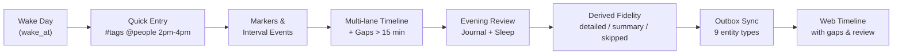

# Increment 2: The Daily Loop — Completion & Verification Report

> **Project:** Life Logger  
> **Milestone:** Increment 2 (The Daily Loop)  
> **Git Release Tag:** [`v0.2.0-increment-2`](../..)  
> **Date:** October 25, 2026  
> **Status:** Engineering Complete — all automated quality gates passed; 14-day field dogfooding pending

---

## 1. Executive Summary

Increment 2 turns the walking skeleton into the product's core loop. A full day can now be captured, structured, reviewed, and synced across Android and Web while remaining offline-first:



Everything in the loop is available offline on Android. The review endpoint derives fidelity from timeline coverage and journal presence; the user is never asked to choose a fidelity level.

---

## 2. Delivered Work Packages

| WP | Deliverable | Status |
|---|---|---|
| **WP 2.1** | Day wake/sleep lifecycle, review state transitions, derived fidelity and coverage | Complete |
| **WP 2.2** | Interval events with precision, multi-lane overlap layout | Complete |
| **WP 2.3** | Hierarchical tag tree, primary tag assignment, Migration 2 schema | Complete |
| **WP 2.4** | Person registry, alias matching, event participants | Complete |
| **WP 2.5** | Deterministic rule-based quick-entry parser v0 with 31 parser tests | Complete |
| **WP 2.6** | Journal entries, persistence, API, Android/Web display | Complete |
| **WP 2.7** | Timeline/gap engine and multi-lane UI on Web + mini timeline on Android | Complete |
| **WP 2.8** | End-of-day review modal/wizard with gap templates, journal, sleep, completion summary | Complete |
| **WP 2.9** | Transactional sync for all nine entity types and rejection-safe mobile outbox | Complete |

---

## 3. Architecture & Key Files

### Domain (`packages/domain`)
- `timeline.ts`: `computeTimelineLanes`, `findTimelineGaps`, `mergeIntervals`, `calculateUnionDuration`.
- `day-lifecycle.ts`: `wakeDay`, `sleepDay`, `beginDayReview`, `completeDayReview`, `calculateDayFidelity`, `calculateDayCoverage`.
- `tags.ts`: path normalization, tag tree construction, ancestor creation, primary tag resolution.
- `people.ts`: case-insensitive name/alias matching and participant resolution.
- `quick-entry.ts`: deterministic parser (`rule-parser-v0`) and event builder.

### Persistence (`packages/persistence`)
- Migration 2 adds `tags`, `events`, `event_tags`, `people`, `event_participants`, `journal_entries`, `captures`, plus indexes.
- SQLite repositories for every new entity with LWW upserts, soft deletes and cursor deltas.
- Upgrade tests cover an empty database and a v1 database upgraded to v2.

### Sync & Server (`packages/sync`, `apps/server`)
- Nine sync types: `marker`, `day`, `event`, `tag`, `event_tag`, `person`, `event_participant`, `journal_entry`, `capture`.
- Push ingestion is one atomic transaction; unknown parent days are auto-created.
- Pull merges all deltas under one cursor and extends same-timestamp pages to prevent loss.
- Daily Loop endpoints: day timeline, journal, review, events, tags, people, captures.

### Android (`apps/android`)
- Quick-entry box with parsed preview and `#tag` / `@person` suggestion chips.
- One-tap marker capture and dependency-ordered outbox enqueueing.
- Mini day timeline with event lanes and highlighted gaps.
- Offline end-of-day review: fill gaps with templates, write journal, record sleep, derive fidelity.
- Rejected sync records stay pending instead of being silently dropped.

### Web (`apps/web`)
- Multi-lane day timeline with proportional event blocks, overlap lanes and dashed gap windows.
- Coverage bar, gap chips, quick-entry preview, event tag display, journal, markers.
- Review modal with gap templates, journal prompt, sleep time and completion summary.

---

## 4. Test Verification

All suites pass via Vitest:

```text
 ✓ packages/domain/test/conflict.test.ts            (4)
 ✓ packages/domain/test/day-boundary.test.ts        (4)
 ✓ packages/domain/test/day-lifecycle.test.ts       (10)
 ✓ packages/domain/test/timeline.test.ts            (8)
 ✓ packages/domain/test/tags-people.test.ts         (7)
 ✓ packages/domain/test/quick-entry.test.ts         (31)
 ✓ packages/persistence/test/sqlite-day-repository.test.ts      (1)
 ✓ packages/persistence/test/sqlite-marker-repository.test.ts   (5)
 ✓ packages/persistence/test/sqlite-daily-loop.test.ts          (8)
 ✓ packages/sync/test/outbox.test.ts                (2)
 ✓ apps/android/test/mobile-sync.test.ts            (2)
 ✓ apps/android/test/mobile-daily-loop.test.ts      (3)
 ✓ apps/server/test/server.test.ts                  (3)
 ✓ apps/server/test/daily-loop.test.ts              (6)

 Test Files  14 passed (14)
      Tests  94 passed (94)
```

Additional gates:

| Gate | Result |
|---|---|
| Root TypeScript build (`tsc -b`) | Passed |
| Web production build (`tsc -b && vite build`) | Passed |
| Android typecheck (`tsc --noEmit -p apps/android`) | Passed |
| Quick-entry save/outbox test | `< 50 ms` asserted |
| Rejected sync records remain pending | Asserted |

---

## 5. Benchmark Results vs. Targets

Recorded at [`docs/benchmarks/increment-2-baseline.json`](../benchmarks/increment-2-baseline.json):

| Metric | Target | Measured |
|---|---|---|
| Single marker save (avg) | `< 50 ms` | **0.036 ms** |
| Single marker save (p95) | `< 50 ms` | **0.070 ms** |
| Batch ingest, 5,000 records | `< 500 ms` | **152.95 ms** |
| Day timeline query (avg) | `< 15 ms` | **0.085 ms** |
| Quick-entry parse (avg) | `< 2 ms` | **0.016 ms** |
| Single event save (avg) | `< 15 ms` | **0.033 ms** |
| 50-event lane layout (avg) | `< 30 ms` | **0.059 ms** |
| 50-event lane layout (p95) | `< 30 ms` | **0.087 ms** |

All benchmark targets passed.

---

## 6. Quality Gate Checklist

- [x] Domain entities, parser and derived algorithms implemented with unit tests.
- [x] Migration 2 tested from empty and from the prior v1 schema.
- [x] Six new entity types plus links sync transactionally.
- [x] Quick-entry save latency budget asserted in the Android test (`< 50 ms`).
- [x] Parser never throws; invalid syntax remains in the title and defaults to `now`.
- [x] Fidelity is derived server-side, never accepted from the client.
- [x] Android and Web review flows both close the loop offline/online.
- [x] All 94 automated tests green; all typechecks and web build green.
- [ ] **14 consecutive days of real dual-device dogfooding** — requires calendar time with the deployed phone + PC setup; not automatable.
- [x] Release tagged `v0.2.0-increment-2`.

---

## 7. Known Limitations / Next Steps

1. **Field dogfooding:** the engineering milestone is complete, but the specification's 14-day real-use gate must still be run by the user.
2. Android currently uses the portable in-memory storage adapter in Expo; production builds should bind the same interface to `expo-sqlite` for process-restart durability.
3. Inline completion is suggestion-chip based rather than a caret-position dropdown; this covers the v0 UX while remaining deterministic.
4. Re-parsing historical captures after future parser upgrades is supported by stored `raw_text`, but no migration/replay job is implemented yet.
5. Increment 3 candidates: context observations UI, week/month rollups, search, and richer participant metadata.

---

## 8. Release Command

```bash
git add .
git commit -m "feat: complete Increment 2 Daily Loop"
git tag -a v0.2.0-increment-2 -m "Increment 2: The Daily Loop"
```
