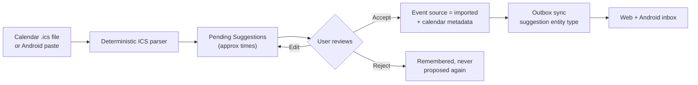

# Increment 3: Suggestions and the First Extension — Completion & Verification Report

> **Project:** Life Logger  
> **Milestone:** Increment 3 (Suggestion Inbox + Calendar ICS extension)  
> **Git Release Tag:** `v0.3.0-increment-3`  
> **Date:** October 25, 2026  
> **Status:** Engineering Complete — all automated quality gates passed; 14-day field dogfooding pending

---

## 1. Executive Summary

Increment 3 adds the boundary between automated sources and the timeline. Imported data no longer creates events directly. Instead, extensions write Suggestions into an inbox, and only an explicit user action turns a suggestion into an Event:



The Calendar extension was chosen ahead of call logging because it is cross-platform and avoids Spike D and Android call-log permissions.

---

## 2. Delivered Work Packages

| WP | Deliverable | Status |
|---|---|---|
| **WP 3.1** | Suggestion inbox with accept, reject and edit on Web and Android; source recorded on every record | Complete |
| **WP 3.2** | Extension registry (tags, dimensions, owned tables), `SuggestionWriter` core interface, Migration 3 | Complete |
| **WP 3.3** | Calendar extension: ICS parsing, deterministic suggestion IDs, first-occurrence import with RRULE retained, module-owned `calendar_items` | Complete |
| **WP 3.4** | Extension and suggestion tests, including accepted suggestion becoming an `imported` Event | Complete |
| **Spike D** | Call-log access | Skipped — calendar went first |

---

## 3. Architecture & Key Files

### Domain (`packages/domain`)
- `suggestions.ts`: `buildSuggestion`, `editSuggestion`, `acceptSuggestion`, `rejectSuggestion`, `buildEventFromSuggestion`, confidence clamping and validation. Accept/reject only operate on pending suggestions.
- `calendar.ts`: tolerant ICS parser (line unfolding, quoted parameters, timezones, all-day events, `DURATION`, `VALARM` exclusion) and `calendarEventsToSuggestions`. Malformed VEVENTs are skipped, never thrown.
- `extensions.ts`: `ExtensionRegistry`, built-in `CALENDAR_EXTENSION`, and the extension-facing `SuggestionWriter` interface.
- Stable IDs use FNV-1a over the calendar UID: `suggestion-calendar-<hash>`.
- Calendar suggestions use `startPrecision = approx` and `endPrecision = approx` (or `unknown` when no end exists) until the user accepts.

### Persistence (`packages/persistence`)
- Migration 3 adds `suggestions` and `calendar_items` with status/external-ID indexes.
- `SqliteSuggestionRepository`: LWW upserts, soft deletes, status filtering, `(source, external_id)` lookup and cursor paging.
- `SqliteCalendarItemRepository`: module-owned metadata keyed by `event_id` and cascaded when the accepted event is deleted.
- Upgrade tests cover an empty database and a v2 database upgraded in place to v3.

### Sync & Server (`packages/sync`, `apps/server`)
- Tenth sync entity type: `suggestion`, pushed and pulled alongside the Daily Loop entities.
- The server rejects an accepted suggestion whose event is unknown by clearing `acceptedEventId`, preventing a dangling foreign key.
- Accepting a calendar suggestion on the server creates the event and writes `calendar_items` in one transaction. Offline accepts pushed later also create the metadata row once the event exists.
- Mutation timestamps are clamped with `resolveUpdateTime` so a lagging client clock cannot lose LWW.
- API surface: suggestion list/edit/accept/reject, extension registry, and Calendar ICS import.

### Web (`apps/web`)
- `SuggestionInbox.tsx`: pending list with source, confidence, approximate-time badge, notes, accept/edit/reject actions, and `.ics` file import with a summary of imported, duplicate and skipped entries.
- Suggestions are loaded with the day timeline and refreshed after every action.

### Android (`apps/android`)
- Offline suggestion store and outbox support, including pull application for newer remote suggestions.
- Paste-in ICS import deduplicates against locally known calendar external IDs, including rejected suggestions.
- Accept creates the imported event, tag/person links and accepted suggestion locally within the normal `< 50 ms` save path, then queues them for sync.
- Reject and edit persist locally and synchronize later; suggestions are pulled even when the outbox is empty.

---

## 4. Test Verification

All suites pass via Vitest:

```text
 ✓ packages/domain/test/conflict.test.ts                         (4)
 ✓ packages/domain/test/day-boundary.test.ts                     (4)
 ✓ packages/domain/test/day-lifecycle.test.ts                    (10)
 ✓ packages/domain/test/timeline.test.ts                         (8)
 ✓ packages/domain/test/tags-people.test.ts                      (7)
 ✓ packages/domain/test/quick-entry.test.ts                      (31)
 ✓ packages/domain/test/suggestions.test.ts                      (10)
 ✓ packages/domain/test/calendar.test.ts                         (10)
 ✓ packages/persistence/test/sqlite-day-repository.test.ts      (1)
 ✓ packages/persistence/test/sqlite-marker-repository.test.ts   (5)
 ✓ packages/persistence/test/sqlite-daily-loop.test.ts          (8)
 ✓ packages/persistence/test/sqlite-suggestions.test.ts         (7)
 ✓ packages/sync/test/outbox.test.ts                             (2)
 ✓ apps/android/test/mobile-sync.test.ts                         (2)
 ✓ apps/android/test/mobile-daily-loop.test.ts                   (3)
 ✓ apps/android/test/mobile-suggestions.test.ts                  (4)
 ✓ apps/server/test/server.test.ts                               (3)
 ✓ apps/server/test/daily-loop.test.ts                           (6)
 ✓ apps/server/test/suggestions.test.ts                          (7)

 Test Files  19 passed (19)
      Tests  132 passed (132)
```

Additional gates:

| Gate | Result |
|---|---|
| Root TypeScript build (`tsc -b`) | Passed |
| Web typecheck + production build (`vite build`) | Passed |
| Android typecheck (`tsc --noEmit -p apps/android`) | Passed |
| Marker/quick-entry save/outbox budget | `< 50 ms` asserted, including offline suggestion accept |
| Parser never throws | Malformed ICS blocks reported in `skipped` |
| Migration 3 from empty and from v2 | Passed |
| Rejected calendar item is not re-proposed | Asserted in domain, repository and server tests |
| Offline accept reconciles calendar metadata | Asserted in server sync test |

---

## 5. Benchmark Results vs. Targets

Recorded at [`docs/benchmarks/increment-3-baseline.json`](../benchmarks/increment-3-baseline.json):

| Metric | Target | Measured |
|---|---|---|
| Single marker save (avg) | `< 50 ms` | **0.034 ms** |
| Single marker save (p95) | `< 50 ms` | **0.051 ms** |
| Batch ingest, 5,000 records | `< 500 ms` | **183.10 ms** |
| Day timeline query (avg) | `< 15 ms` | **0.270 ms** |
| Quick-entry parse (avg) | `< 2 ms` | **0.0127 ms** |
| Quick-entry parse (p95) | `< 2 ms` | **0.0149 ms** |
| Single event save (avg) | `< 15 ms` | **0.054 ms** |
| 50-event lane layout (avg) | `< 30 ms` | **0.0736 ms** |
| 50-event lane layout (p95) | `< 30 ms` | **0.1122 ms** |
| ICS parse, 200 events (avg) | `< 50 ms` | **1.457 ms** |
| Calendar suggestion build, 200 events | `< 25 ms` | **0.690 ms** |
| Single suggestion save (avg) | `< 15 ms` | **0.0356 ms** |
| Pending suggestion query (avg) | `< 15 ms` | **0.829 ms** |
| Suggestion accept flow (avg) | `< 25 ms` | **0.098 ms** |

All benchmark targets passed. Increment 2 metrics remain within budget on the same harness.

---

## 6. Quality Gate Checklist

- [x] Suggestions support accept, reject and edit on both apps, with the source recorded.
- [x] Automated sources write Suggestions; accepted suggestions become Events with `source = imported`.
- [x] Calendar times remain `approx` until confirmed.
- [x] Declined external items are remembered and not re-proposed.
- [x] Extension registration exposes tags, dimensions and module-owned tables.
- [x] Migration 3 tested from empty and from the previous v2 release schema.
- [x] Suggestion sync, dedupe and LWW behaviour covered by tests.
- [x] Parser is total: invalid input yields skips, never an exception.
- [x] Marker and quick-entry save budgets remain under 50 ms.
- [x] Web build and Android typecheck green; no emojis in the UI.
- [x] All 132 automated tests green.
- [ ] **14 consecutive days of real dual-device dogfooding** — requires calendar time with the deployed phone + PC setup; not automatable.
- [x] Release tagged `v0.3.0-increment-3`.

---

## 7. Known Limitations / Next Steps

1. **Field dogfooding:** the engineering milestone is complete, but the specification's 14-day real-use gate still has to be run by the user.
2. Android still uses the portable in-memory storage adapter in Expo; production builds should bind the same interface to `expo-sqlite` for process-restart durability.
3. Recurring calendar events import their first occurrence only; the RRULE is stored for later expansion but no expansion job runs yet.
4. Web calendar import requires the server. Android supports offline paste import, but it accepts text rather than reading the device calendar provider.
5. `calendar_items` is populated on accept and reconciled from offline accepts; recurring-instance linking will need revisiting when expansion ships.
6. Increment 4 candidates: things and dynamic types, full-text search, and the Diagnostics extension.

---

## 8. Release Command

```bash
git add .
git commit -m "feat: complete Increment 3 suggestions and Calendar extension"
git tag -a v0.3.0-increment-3 -m "Increment 3: Suggestions and the First Extension"
```
