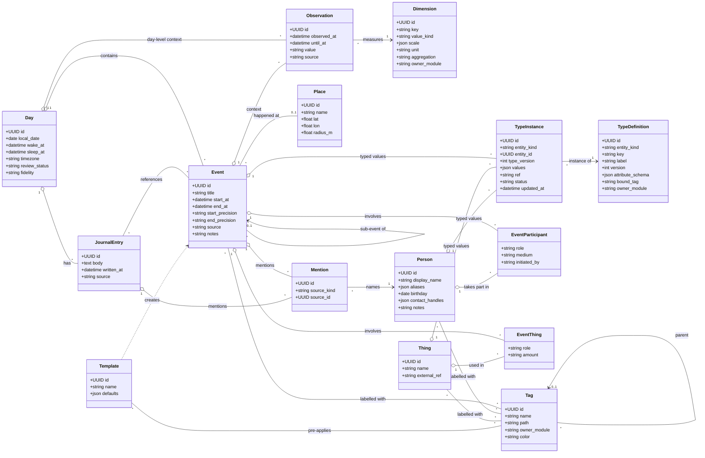
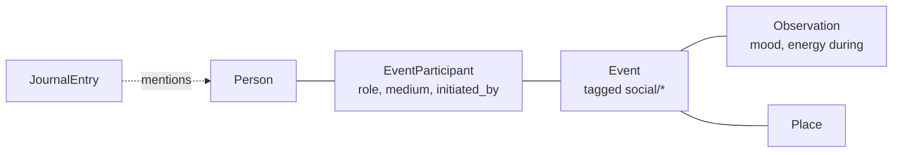
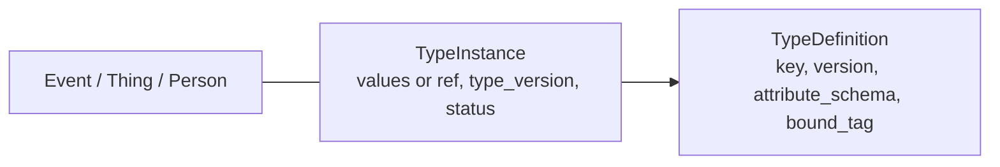
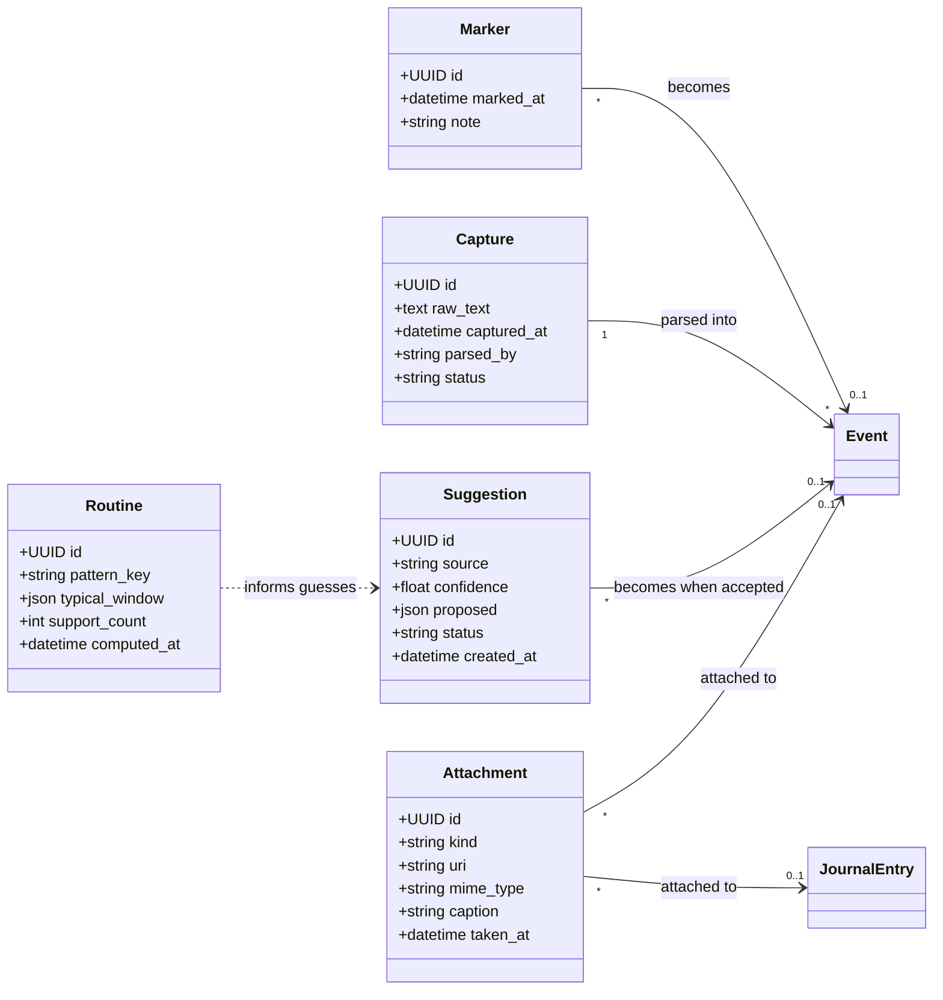
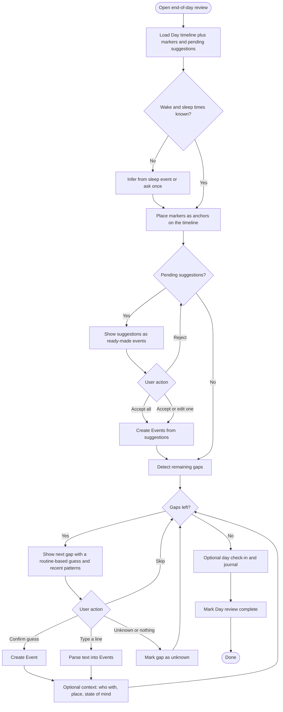
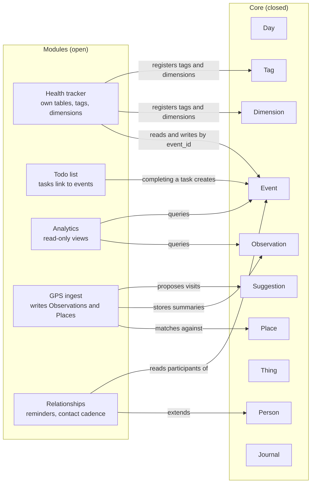
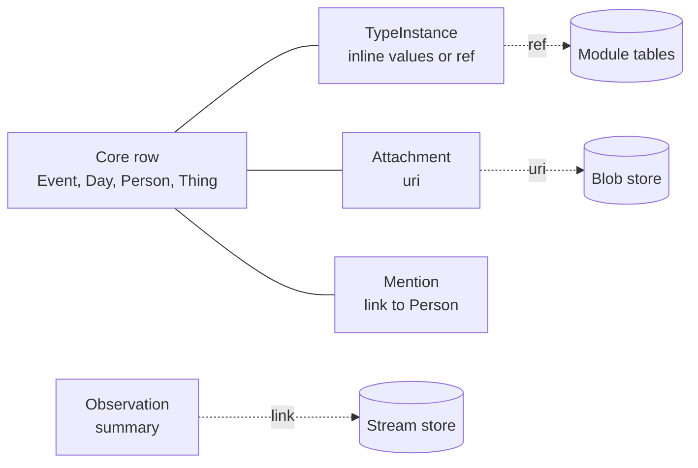
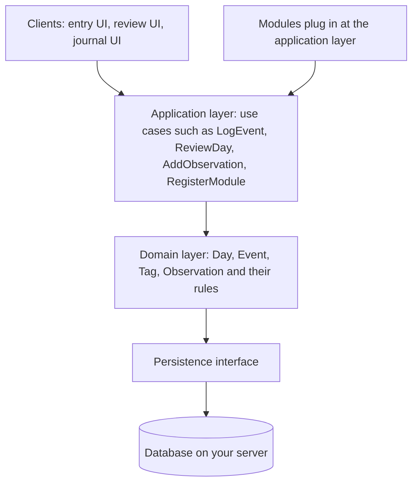
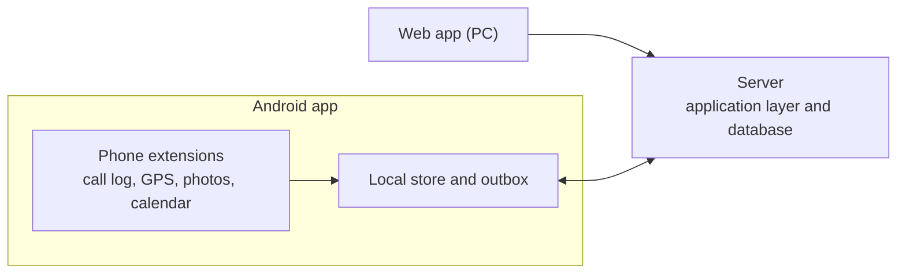

# Life Logger: High-Level Design (Paradigm & Model)

**Status:** Draft 9, high-level only. The tech stack is intentionally undecided, and edit history is deferred apart from the sync minimum in 8.1.
**Scope of this doc:** the conceptual model that everything else (schema, API, UI) will be derived from.

---

## 1. Goal

A personal, self-hosted system that records *what you did and what state you were in*, as a timeline of **events**, enriched with **context**, plus free-text **journaling**. It must be open enough that future modules (health tracker, todo list, ...) can reuse the same data without changing the core.

**Non-goals (v1):** raw audio/video, privacy/multi-tenant concerns, real-time sensing. Input is manual or prompted, mostly at end of day.

---

## 2. Core paradigm

Eight ideas carry the whole design.

1. **Everything is an interval.** An event has a start and an optional end. A "point" event (took a pill) is just an interval with no end. Multitasking is free: events may overlap, and the overlap is *derived* from timestamps, never stored.
2. **Meaning comes from tags, not types.** Instead of a fixed `type` enum, events carry tags from a hierarchical, user-extensible taxonomy (`sleep`, `hygiene/brush`, `work/coding`, `food/lunch`). Modules are *views over tags*.
3. **Context is a generic observation.** Mood, energy, location, weather and so on are all the same shape: *(dimension, value, time, subject)*. Adding a new kind of context means adding a dimension row, not a column.
4. **Core is closed, modules are open.** The core knows only about Day, Event, Tag, Observation, Place, Person, Journal. Modules own their own tables and reference core rows by ID. They never alter core tables.
5. **Truthfulness metadata is first-class.** Since most data is reconstructed at night, every record says *how* it was captured (live / backfilled / prompted / imported) and *how precise* its times are.
6. **Frictionless by construction.** One line is a valid log, everything else is optional and can be added later or never. Automation only *proposes* (Suggestions); you confirm in bulk. Section 5.3 lists the rules.
7. **Types are data.** New kinds of events, things and people are created at runtime through a type registry (a name plus an attribute schema), with no code change or migration. Tags stay free-form. Types only add structured fields where you want them. Their values live in separate `TypeInstance` records, so core rows stay clean.
8. **Extras live by reference.** Anything beyond the core (type values, module data, files, dense sensor streams, mentions) sits outside the core rows and is attached through a small pointer, the way git LFS keeps a pointer in the repo and the content elsewhere. Core rows never grow new columns or blobs. See 6.1.

---

## 3. Domain model (conceptual class diagram)

### 3.1 Entity notes

| Entity | Purpose | Key decisions |
|---|---|---|
| **Day** | A logical day, bounded by wake/sleep rather than midnight | Sleep spans midnight, so a midnight-bounded day cuts the most important event in half. Events still store absolute UTC timestamps. `Day` is a grouping and review unit. `fidelity` (`detailed`, `summary`, `skipped`) is **derived** from timeline coverage and journal presence, never asked for. |
| **Event** | Something you did over an interval | `start_precision`/`end_precision` take `exact`, `approx` or `unknown`. `source` takes `live`, `backfill`, `prompted`, `imported`. Type-specific fields live in `TypeInstance` records (see 3.4). |
| **Tag** | Classification, hierarchical | One tag tree replaces the separate "category" and "tag" ideas. A `primary` flag on the event-tag link marks the main one. `owner_module` lets modules register their own tags. |
| **Template** | One-tap quick-log preset | Pre-fills title, tags, typical duration (e.g. "Brush teeth", "Wake up", "Lunch"). |
| **Dimension** | Definition of a measurable context axis | See 3.2. Carries a `unit` and an `aggregation` rule (`sum`, `avg`, `last`, `max`) so weekly totals and averages are computed correctly. |
| **Observation** | A value of a dimension at a time, attached to an event, a time range or a day | Universal context container: mood, energy, GPS fix, weather. |
| **Place** | Named known location | v1 is named places with a radius. Raw GPS trails come later as Observations on a GPS dimension. |
| **Person** | Someone you interact with | Stored once, reused everywhere. The user is implicit and has no Person row. Relationship type (family, friend, colleague, ...) is a tag on the person, not a column. |
| **EventParticipant** | Link between an Event and a Person | Carries `role` (`with` in v1, kept so other roles can be added later), `medium` (`in_person`, `call`, `text`, `video`, `online`) and `initiated_by` (`me`, `them`, `mutual`). |
| **Mention** | A person who came up in an event or journal entry but took no part | Separate from EventParticipant. Optional and off by default. A link record that points at a source (Event or JournalEntry) and a Person, referenced the same way as TypeInstance (see decision 15). |
| **Thing** | A non-person object of an event: a show, game, book, meal, tool | Same pattern as Person. The link to an event carries a `role` (`watched`, `played`, `ate`, `used`) and an optional `amount`. See 3.4. |
| **EventThing** | Link between an Event and a Thing | Carries `role` (`watched`, `played`, `ate`, `used`) and an optional free-text `amount` ("2 slices", "30 pages"). |
| **TypeDefinition** | Registry entry that gives a kind of Event, Thing or Person its own structured fields | Created at runtime. See 3.4. |
| **TypeInstance** | The values of one type for one Event, Thing or Person | Separate from the core row. Holds `values` (JSON) inline, or a `ref` to a module table once the data is large or promoted, plus the `type_version` it was written under and a `status` (`valid` or `draft`). One entity can have several. See 3.4. |
| **JournalEntry** | Free-text reflection | Primarily tied to a Day, with optional links to events. |

### 3.2 State-of-mind model (Dimensions)

Since the goal is to capture the user's *whole* state, context is seeded with a starter set of dimensions grouped by facet. All are optional and can be sampled at any time, not only per event.

| Facet | Dimensions (starter set) | Scale |
|---|---|---|
| **Affect** | valence (unpleasant to pleasant), arousal/energy (calm to activated) | 1-5 each |
| **Emotions** | emotion labels (joy, anxiety, anger, boredom, calm, ...) | multi-select, optional intensity |
| **Cognition** | focus, mental clarity, motivation, stress/overwhelm | 1-5 |
| **Body** | physical energy, sleepiness, hunger | 1-5 |
| **Social** | alone vs. with others, social battery. *Who* you were with comes from EventParticipant, not an observation | enum, 1-5 |
| **Situation** | location (Place or GPS), activity setting (home/outside/transit), weather | ref / enum / auto |
| **Meta** | "how much did I enjoy this", "was this intentional or autopilot" | 1-5, bool |

Why this shape:
- **Valence + arousal** is the standard minimal model of affect, and it avoids forcing you to pick one mood word.
- **Emotion labels** add the nuance that the two numbers cannot.
- A **Dimension registry** keeps this open: a future health module adds `pain_level` or `blood_pressure` as new rows without a migration.

### 3.3 People and interactions

An **interaction is not a separate entity**. It is an Event with one or more participants.

- "Called Amma while walking home" is an Event (tags `social/call`, `transit/walk`) with one EventParticipant (medium `call`).
- Because it is a normal Event, it sits on the same timeline, overlaps with other events, and can carry state-of-mind observations ("how did I feel during this?").
- "Everything with person X" is a query through EventParticipant. Interaction frequency, recency and mood-after-meeting-X are all derived views, not stored.

Rules:
1. An EventParticipant means the person was part of the event. A person who only came up and took no part is recorded as a separate `Mention`, which is optional and off by default.
2. An event may have many participants, so a group dinner is one event with several rows.
3. People are created on the fly during review ("who were you with?") with autocomplete over existing people. Cleanup (merging duplicates, adding details) can happen later.
4. Person-to-person relationships (graph of who knows whom) and per-participant observations are out of scope for v1, though the model leaves room for both.

### 3.4 Things and dynamic types

**Things** work like People: a Thing is stored once and linked to many events. "Played a game for 3 hours" is an Event linked to a Thing, so "everything I've watched", "hours per game" and "how I feel after eating X" are queries rather than features.

**Dynamic types** let you add custom kinds later without touching the schema. A `TypeDefinition` has an `entity_kind` (`event`, `thing` or `person`), a `key`, a label, a `version` and an `attribute_schema` describing the fields. The values are stored **separately**, in `TypeInstance` records that point at the entity and at the type. Core rows carry no type payload.

| entity_kind | Type key | Fields (stored in a TypeInstance) |
|---|---|---|
| event | `meal` | cooked_or_ordered, rough_portion |
| event | `workout` | muscle_group, equipment |
| thing | `game` | platform, genre |
| thing | `show` | season, episode |
| thing | `book` | author, total_pages |
| person | `family` | relation_label |

Rules:
1. Types are created **at runtime** and are pure data. No migration is needed.
2. A type's values live in a **TypeInstance**, a separate record that references the entity and the type. Event, Thing and Person rows carry no type payload.
3. An entity can have **several TypeInstances**, one per type. An event tagged `food/meal` and `social/dinner` can carry the fields of both.
4. Each instance records the `type_version` it was written under, so changing a type's schema never invalidates old data.
5. Values are checked against the schema in the application layer. A value that fails validation is saved with `status = draft`. A save is never blocked.
6. A type can be **bound to a tag** (`bound_tag`), so tagging an event `food/meal` offers the meal fields automatically.
7. Types are optional. Untyped events and things work fully.
8. If a field is queried heavily, a module can promote it to its own table. The TypeInstance then keeps a `ref` to that table instead of inline values, and entry does not change.
9. Tags remain the primary classification. Types add structure and never replace tags.
10. **Descriptors vs. measurements.** Type fields hold descriptors, meaning facts about what kind of thing this is (platform, genre, equipment). Measured values (distance, effort, mood) are Observations on a Dimension, so they keep units and aggregation. How much of a Thing was used in one event (30 pages, 2 slices) is `EventThing.amount`.

### 3.5 Capture and automation entities

| Entity | Purpose | Key decisions |
|---|---|---|
| **Marker** | One-tap "something happened now", with an optional few words | Costs two seconds during the day. At review, markers show as anchors on the timeline and you expand each into an event. |
| **Capture** | The raw text you typed ("lunch with Rahul at 2, then coded till 6") | Parsed into events by a rule-based parser first, with an optional local model on top. No hosted API is required. Keeping the original text allows re-parsing later with a better parser. |
| **Suggestion** | A machine-proposed event awaiting accept, edit or reject | `source` (gps, calendar, screen_time, browser, git, routine, ...) and `confidence`. **Nothing automated writes straight into the timeline.** |
| **Routine** | A *learned* pattern of your usual behaviour ("wake 7:00-8:00, brush right after") | Inferred from history and rebuildable at any time. It is never declared or hand-edited, and it is only used to guess gaps and pre-fill suggestions. |
| **Attachment** | Photo, screenshot, link or file | Linked to an event or a journal entry. The file lives in the blob store (see 7.1). |

---

## 4. Handling multitasking

Events overlap freely. The system derives concurrency at query time.

```mermaid
gantt
    title Example: one morning, overlapping events
    dateFormat HH:mm
    axisFormat %H:%M
    section Sleep
    Sleep                 :done, 00:00, 07:30
    section Morning routine
    Wake up and stretch   :07:30, 07:45
    Brush teeth           :07:45, 07:50
    Shower                :07:50, 08:05
    section Concurrent
    Commute               :08:30, 09:15
    Podcast               :08:35, 09:10
    Texting friend        :08:50, 09:00
```

- *Commute*, *Podcast* and *Texting* overlap and are three independent events, with no parent link needed.
- If one genuinely **contains** another (e.g. "Study session" containing "Break"), use `parent_event_id`.
- The review UI renders overlapping events as parallel lanes. Lane assignment is computed, never stored.

---

## 5. Capture flows

### 5.1 Input modes (v1)

1. **Markers:** during the day, one tap to drop a timestamp with an optional few words.
2. **Manual entry:** add an event with a start time and anything else you feel like adding.
3. **Quick-log templates:** one tap for routine items (wake, brush, meals). The time defaults to now or a time you choose.
4. **Free-text capture:** type a sentence or two and let the parser turn it into events.
5. **End-of-day gap review (primary flow):** the app places your markers and pending suggestions on the Day timeline, then asks about what's left: "What were you doing between 14:10 and 16:30?"
6. **Journal:** a free-text entry for the Day, with optional attachments.

### 5.2 End-of-day review (activity diagram)

The gaps are **derived**. The only stored state is `Day.review_status` (`open`, `in_review`, `complete`).

### 5.3 Frictionless capture principles

Logging effort decides whether this system survives, so these rules apply to every flow:

1. **One line is a valid log.** Only a start time is required, and it defaults to now. Everything else is optional.
2. **Enrich later, or never.** Capture the minimum now. Tags, people, place and mood can be added at review. "Completeness" is derived, never demanded.
3. **Suggest, don't ask.** Tags come from the text, templates and history. People come from who you usually see at that time. The place comes from GPS. State of mind can carry over from the last sample.
4. **"Unknown" is a valid answer.** A gap can be marked unknown in one tap.
5. **Everything is skippable and resumable.** Abandon a review halfway and nothing is lost.
6. **Bulk first, details second.** "Accept all" on suggestions is always available.
7. **Missed days cost nothing.** `Day.fidelity` is *derived* (`detailed`, `summary`, `skipped`) from coverage and journal presence, so you never mark a day as skipped. A catch-up queue lists unreviewed days, newest first, and you fill each at whatever level you have energy for.
8. **Never block a save.** Failed validation (for example, a typed field that doesn't match its schema) saves the `TypeInstance` flagged as a draft.

---

## 6. Extensibility: how modules plug in

**Module contract (conceptual):**
1. A module **registers** its tags, dimensions and templates, with `owner_module` set so they can be managed or removed together.
2. A module **owns its tables** and links by `event_id`, `day_id` or `observation_id`. Core tables are never altered.
3. A module may write to core only through the core interface (create event, add observation, propose suggestion). It never writes to core tables directly. **Automated sources (GPS, calendar, screen time, imports) write Suggestions, never Events.**
4. Per-event module data that needs to travel with the event goes in a `TypeInstance` of a type the module registers (`owner_module` set), or in the module's own tables. It never goes on the core row.

Example mappings:

| Module | Uses from core | Adds |
|---|---|---|
| Health tracker | events tagged `sleep`, `exercise`, `food/*`; body dimensions | metrics tables (weight, vitals), health tags and dimensions |
| Todo list | tags, days | Task table; completing a task creates an Event |
| GPS | Place, Observation | ingest pipeline, geofence matching |
| Relationships | Person, EventParticipant, social events | contact cadence, "haven't talked to X in a while" reminders, birthdays |
| Analytics | everything, read-only | reports and dashboards |

### 6.1 Extras live by reference

The core never absorbs extra data. It holds a small pointer and the data lives elsewhere, the way git LFS stores a pointer in the repo and the content in a separate store.

| Extra | Pointer held by the core | Content lives in |
|---|---|---|
| Type values | `TypeInstance` (inline `values`, or a `ref` when large or promoted) | the instance, or the owning module's table |
| Module data | a `TypeInstance` of a module-owned type, or the module's own tables keyed by `event_id` / `day_id` | module tables |
| Files | `Attachment.uri` | blob store |
| Dense signals | an Observation summary that links to the raw stream | stream store |
| Mentions | `Mention` | a link record, separate from EventParticipant |

Rules:
1. Reading a core row never requires resolving a pointer. Extras are loaded on demand.
2. A pointer names its owner (a type or a module) and where the content is.
3. Removing a module removes its referenced data and leaves the core rows intact. A pointer whose content is gone resolves to "missing" and is never an error.
4. Adding a new kind of extra means adding a type, a module or a store, never a core column.

---

## 7. Time and data conventions

- All timestamps are stored as **UTC plus an IANA timezone** (on Day or Event), so travel doesn't corrupt history.
- IDs are **UUIDs** to allow offline creation and future sync.
- **Precision** is explicit. Never silently round "around 3pm" to 15:00:00.
- **Derived, not stored:** overlaps, gaps, lanes, daily totals per tag.
- **Soft-deletion / history:** *deferred*, see Open Decisions. Sync needs at least `updated_at` and a deletion marker (8.1).
- **Storage tiers:** see 7.1.

### 7.1 Storage tiers

| Tier | Holds | Notes |
|---|---|---|
| **Relational core** | Day, Event, Tag, Person, Thing, Observation, Journal, Suggestion, TypeDefinition, ... | Source of truth. |
| **Stream store** | Dense sensor data: GPS trails, heart rate, other high-frequency signals | Time-series table, separate retention. Observations hold the human-meaningful summary ("at the gym 17:10 to 18:20") and link to the raw stream. |
| **Blob store** | Attachment files | Referenced by URI. Filesystem vs. object store is decided with the stack. |
| **Search index** | Full-text over event titles, notes and journals, plus embedding vectors for semantic recall ("when did I last feel stuck?") | Rebuildable from the core. Full-text comes first. Embeddings are optional and can wait, generated by a small local model and regenerated if that model changes. |

---

## 8. Layering (technology-agnostic)

The stack is chosen later. This layering holds whichever you pick. The persistence interface is the one place that knows which database is in use, so the engine can be swapped later without touching the layers above it.

### 8.1 Clients and sync

The plan is a PC-first web app and a lighter Android companion that still has most of the features. Both talk to the same server through the application layer.

Rules:
1. The server holds the source of truth. Clients reach it only through the application layer.
2. **Offline capture on Android.** New records get their UUID on the phone and wait in an outbox until a connection is available. Reads come from a cache. A full local copy is a later option.
3. **Sync minimum.** Every syncable record carries `updated_at` and a deletion marker, so edits and deletes can travel between clients. This is the least that decision 2 (edit history) needs. Full history stays deferred.
4. **Conflicts.** Last write wins per record. With one person using both clients, real conflicts are rare.
5. **Phone extensions run on Android.** Call logging, GPS, photos, calendar and screen time read phone data, so they run inside the Android app and push Suggestions to the server through the core interface (module contract 3). A browser cannot read a call log or track location in the background, so the Android app needs a native layer.
6. **Call logging and the Play Store.** Google Play restricts the call log permission to apps registered as the default Phone or Assistant handler, so call logging assumes the app is installed outside the Play Store. Check the current Play policy before relying on this.

Android ship order. "First" means it is in the first Android release. "Later" means it is PC-first, with parity on Android afterwards.

| Feature | Android | Notes |
|---|---|---|
| Markers and quick entry | First | Works offline |
| Today's timeline | First | |
| End-of-day review | First | Answers work offline |
| Journal | First | Works offline |
| Suggestion inbox | First | Fed by the phone extensions |
| Search | Later | |
| Backfilling past days | Later | |
| Managing types, tags and modules | Later | Web only at first |
| Analytics | Later | Web only at first |

### 8.2 Testing

1. **Unit tests on the domain layer.** The layering means these need no database. Targets: derived values (overlaps, gaps, lanes, `Day.fidelity`), precision handling ("around 3pm" never becomes 15:00:00), the free-text parser (with a growing list of example sentences), Suggestion merge, accept and reject, `TypeInstance` validation (a failed check saves the instance as a draft and never blocks the save), and sync (replaying the outbox creates no duplicates, and deletion markers travel).
2. **Persistence contract tests.** One shared suite is written against the persistence interface and run on every database in use. This is what makes decision 18 safe: moving to another database means running the same suite on it.
3. **Small benchmark.** A synthetic dataset (for example five years of days, events and GPS points) and a handful of timed operations: loading one Day's timeline, search, a tag rollup, a sync batch, and saving a marker on Android. It is run occasionally and the results are recorded. Budgets are set after the first numbers come in, except marker-save time on the phone, which is fixed early because the frictionless principles depend on it. A move to another database (decision 18) is triggered by these numbers.
4. **Real-world numbers.** The Diagnostics extension (section 11) records timings and crashes from your own devices, to compare with the benchmark.

---

## 9. Open decisions

| # | Decision | Status |
|---|---|---|
| 1 | Platform: a PC-first web app plus a lighter Android companion with most of the features | **Decided in Draft 8.** The tech stack itself is chosen later |
| 2 | Edit history vs. soft delete only | Deferred. Sync needs at least `updated_at` and a deletion marker (8.1) |
| 3 | Day boundary: wake-to-sleep (proposed) vs. midnight-to-midnight | **Proposed here; please confirm** |
| 4 | One tag tree with a primary flag (proposed) vs. separate category and tag concepts | **Proposed here; please confirm** |
| 5 | Context as generic Observations (proposed) vs. fixed mood columns on Event | **Proposed here; please confirm** |
| 6 | Interactions as Events plus participants vs. a separate Interaction entity | **Decided: Events plus participants** |
| 7 | Record people who were only *mentioned*: a separate `Mention` link (optional, off by default) instead of an `EventParticipant` role | **Decided: separate Mention link** |
| 8 | Person-to-person relationships graph | Deferred (out of v1) |
| 9 | Things as a core entity, with dynamic types via `TypeDefinition` (proposed) | **Proposed here; please confirm** |
| 10 | Which entities get dynamic types: Event, Thing, Person (proposed: all three) | **Proposed here; please confirm** |
| 11 | `Day.fidelity` derived rather than user-set (proposed) | **Proposed here; please confirm** |
| 12 | Tag hygiene: aliases, merge, deprecate | To discuss later |
| 13 | Attachment storage location and size limits | Deferred with the stack |
| 14 | Dynamic-type values in separate `TypeInstance` records (proposed) vs. an `attributes` JSON on core rows | **Decided in Draft 4** |
| 15 | How `TypeInstance` references its entity: polymorphic columns, one table per entity kind, or nullable keys | Deferred to the ER stage |
| 16 | Capture parsing rule-based first with an optional local model, and embeddings optional and later | Applied in Draft 4. Say if hosted APIs should be allowed |
| 17 | Extras (type values, module data, files, streams, mentions) attach to the core by reference, like git LFS pointers | **Decided in Draft 5** |
| 18 | Database: start with an existing general-purpose database behind the persistence interface, and move to a custom store only if performance requires it | **Decided in Draft 7.** The specific engine is chosen with the stack |
| 19 | Sync approach: offline outbox on Android with last-write-wins per record first, a full local copy later | **Proposed here; please confirm** |
| 20 | Android implementation: native, or cross-platform with native plugins | Deferred with the stack |
| 21 | Testing: unit tests on the domain layer, a shared persistence contract suite, and a small benchmark on synthetic data | **Decided in Draft 9** |
| 22 | Diagnostics data stays on your own server and devices, with a rolling retention window and no life content in crash reports | **Proposed here; please confirm** |

---

## 10. Parked for later (not in v1, no model changes needed yet)

| Item | Idea |
|---|---|
| **Reflection templates** | Optional structured journal prompts, such as a weekly or monthly review ("what drained me, what gave energy, what surprised me"). |
| **Durable export** | A plain-text export (JSON Lines plus Markdown journals) with a versioned schema and a nightly copy, so the data outlives the app. |
| **Rollups** | Materialized daily totals per tag and per dimension, so dashboards stay fast over years of data. Derived and rebuildable. |
| **"On this day" and starred moments** | Star flag plus a resurfacing feed. Not yet discussed. |

---

## 11. Extension list (future modules)

Nothing in this list is in v1. Each extension is a module (section 6), so it follows the module contract: it registers its own tags, dimensions and types, owns its own tables, attaches to the core by reference (6.1) and writes to the core only through the core interface. Automated sources write Suggestions, never Events.

### 11.1 The list

| Extension | Status | Source | Writes to core as | Keeps by reference |
|---|---|---|---|---|
| **Calendar** | Named | ICS file or phone calendar | Suggestions (a planned event, "did it happen?") | `calendar_item` table (external id, recurrence), keyed by `event_id` |
| **Call logging** | Named | Phone call log | Suggestions (a call with a Person, `medium = call`) | `call_record` table (number, direction, duration), keyed by `event_id` |
| **Diagnostics** | Named | The app itself (crash handlers, timers, server request timings) | Nothing in the timeline. It writes only its own tables | `crash_report` and `perf_sample` tables with a rolling retention window |
| GPS ingest | Sketched in 6 | Phone location | Suggestions (visits), Observation summaries | Stream store for raw points |
| Health tracker | Sketched in 6 | Manual entry | Events, Observations | Metrics tables (weight, vitals) |
| Todo list | Sketched in 6 | Manual entry | An Event when a task is completed | Task table |
| Relationships | Sketched in 6 | Person and EventParticipant data | Nothing, reminders only | Contact cadence and birthday tables |
| Analytics | Sketched in 6 | Core, read-only | Nothing | Report and dashboard definitions |
| Screen time | Idea | Phone usage stats | Observations (daily totals per app category) | Stream store for raw usage |
| Photos | Idea | Photo library | Suggestions ("12 photos at this place"), Attachments | Blob store for the files |
| Media history | Idea | Watch, listen and read history | Suggestions that link to Things through EventThing | Import table |
| Expenses | Idea | Bank or card exports | Suggestions, Observations (amount with a currency unit) | Transactions table |
| Weather | Idea | Weather lookup for each Day | Observations on the Day | Nothing |

"Named" means you asked for it. "Sketched in 6" means it already appears in the section 6 diagram. "Idea" means it fits the model but is not committed.

### 11.2 The named extensions

**Calendar**
- Accepting a suggestion creates an Event with `source = imported`. A declined item is remembered so it is not proposed again.
- A calendar time is what was planned, so it is marked `approx` until you confirm it.
- Attendees match to People through their contact handle.
- The suggestion asks "did this happen?" and never assumes it did.

**Call logging**
- Direction sets `initiated_by` (outgoing is `me`, incoming is `them`) and duration sets the event interval, so most calls need only one tap to accept.
- Numbers match People through `contact_handles`. An unknown number is asked about once and then remembered.
- Open question: whether missed calls become suggestions or are ignored.

**Diagnostics**
- Crash reports hold the error, app version, device type and screen. They never hold the text of events, journal entries or people.
- Load logging is occasional sampling of a few timings (opening Today, saving a marker, a sync batch), not every action, plus counts of slow server requests and slow queries.
- A crash on the phone is written to a local file and uploaded on the next sync, so a crash while offline is not lost.
- Data stays on your own server and devices, with no hosted telemetry service. Old samples roll off after a retention window chosen later.
- It never writes Events or Observations. This is system data, not part of your life log.
- Its numbers feed the benchmark in 8.2.

### 11.3 Notes that apply to every extension

1. No extension requires a hosted AI service.
2. Several sources can propose the same moment (a calendar item, a GPS visit and a call). They should merge into one Suggestion that lists its sources, so the review queue shows one item. This is settled in the module spec stage.
3. Each extension gets a full spec from the module spec template (section 12, item 6) before it is built.
4. The order is not fixed. Extensions are independent of each other because none of them changes the core.

---

## 12. Next documents (after sign-off on this paradigm)

1. Detailed ER diagram and schema
2. Use-case list and sequence diagrams (log event, review day, register module, GPS ingest)
3. State diagrams (Day review lifecycle, event capture source and precision)
4. API surface
5. UI flows and wireframes
6. Module spec template
