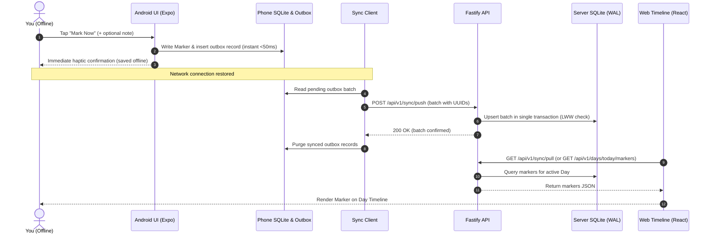

# Step 1: Walking Skeleton — Detailed Implementation Specification

> **Parent Documents:**
> - [life-logger-high-level-design(2).md](../life-logger-high-level-design%282%29.md)
> - [Life Logger Implementation Plan.md](../Life%20Logger%20Implementation%20Plan.md)
>
> **Goal:** One marker saved on an Android device while offline, synced reliably to the server upon reconnection, and displayed on the PC-first web timeline.
>
> **Estimated Effort:** ~15 focused engineering days (including 3.5 days for Spikes A, B, and C).

---

## 1. Executive Summary & Objective

The **Walking Skeleton** is the minimal end-to-end implementation that connects all architectural tiers:
1. **Android Client (`apps/android`):** An offline-first mobile app where tapping a button records a timestamped `Marker` into a local SQLite database and queues it in an outbox.
2. **Sync Subsystem (`packages/sync`):** An idempotent, outbox-driven sync protocol with push/pull endpoints, cursor tracking, and Last-Write-Wins (LWW) conflict handling.
3. **Backend Service (`apps/server`):** A lightweight Fastify/Node.js server handling single-user authentication, sync ingestion, and persistence into SQLite (WAL mode).
4. **Domain Layer (`packages/domain`):** Pure TypeScript entities and logic (Day, Marker, Event, Precision, Logical Day assignment) with zero I/O dependencies.
5. **Persistence Layer (`packages/persistence`):** Clean repository interfaces backed by SQLite and verified by an engine-agnostic contract test suite.
6. **Web Client (`apps/web`):** A React (Vite) interface that loads and displays the Day's markers in chronological order.



---

## 2. Pre-Requisite Spikes (Days 1 – 3.5)

Before building production packages, three timeboxed research spikes must settle critical architecture risks.

### Spike A: Android Offline Persistence & Background Sync
- **Timebox:** 1.5 days.
- **Key Question:** Can a React Native (Expo development build) app write to local SQLite instantly when disconnected, and trigger a reliable outbox flush when connectivity returns or via periodic background tasks?
- **Scope & Validation:**
  - Create a throwaway Expo app with `expo-sqlite`, `expo-network`, and `expo-background-fetch` / `expo-task-manager`.
  - Simulate offline airplane mode: write 100 markers. Measure write latency (target: `< 50ms`).
  - Disable airplane mode: verify `NetInfo` event listener fires and flushes outbox to a mock endpoint.
  - Test background wake: trigger background task using `expo-background-fetch` while app is backgrounded.
- **Decision Outcome:** Validates Decision 20. If React Native background sync fails repeatedly due to Android OS battery optimizations, native Kotlin module for background work will be chosen.

### Spike B: SQLite Performance Under Batch Sync Load
- **Timebox:** 1.0 day.
- **Key Question:** How does SQLite in WAL mode with a single writer perform when an outbox pushes a batch of 5,000 to 20,000 records?
- **Scope & Validation:**
  - Initialize Node.js + `better-sqlite3` test with `PRAGMA journal_mode = WAL; PRAGMA synchronous = NORMAL;`.
  - Benchmark batch upserts: compare individual `INSERT` statements vs. prepared transaction batch (`BEGIN TRANSACTION ... COMMIT`).
  - Measure disk I/O, file locks, and read latency while a large write transaction is in progress.
- **Target:** Ingest 10,000 records in `< 500ms` without blocking concurrent read queries on the timeline.

### Spike C: Logical Day Boundary & Time Handling
- **Timebox:** 1.0 day.
- **Key Question:** Does the wake-to-sleep logical day paradigm hold across midnight, timezone changes, and Daylight Saving Time (DST) transitions?
- **Scope & Validation:**
  - Test suite covering:
    - Event occurring at 01:30 AM before sleep (must assign to previous logical Day).
    - DST autumn clock-back transition (repeat of 01:00 - 02:00) with UTC timestamps and timezone offsets.
    - Long-haul flight crossing 5 timezones during a single waking period.
- **Decision Outcome:** Confirms Decision 3 rules in `packages/domain`.

---

## 3. Repository Layout & Tooling (Work Package 1.1)

### Monorepo Structure
We use `pnpm` workspaces (or `npm` workspaces) with TypeScript project references:

```text
├── package.json
├── pnpm-workspace.yaml
├── tsconfig.base.json
├── .github/
│   └── workflows/
│       └── ci.yml
├── packages/
│   ├── domain/               # Pure TS domain entities, rules, zero I/O
│   │   ├── package.json
│   │   ├── tsconfig.json
│   │   └── src/
│   ├── persistence/          # Repository interfaces, SQLite implementation, contract suite
│   │   ├── package.json
│   │   ├── tsconfig.json
│   │   └── src/
│   └── sync/                 # Sync protocol, outbox engine, serialization
│       ├── package.json
│       ├── tsconfig.json
│       └── src/
├── apps/
│   ├── server/               # Fastify API, single-user auth, migrations runner
│   │   ├── package.json
│   │   └── src/
│   ├── web/                  # Vite + React timeline app
│   │   ├── package.json
│   │   └── src/
│   └── android/              # Expo React Native mobile client
│       ├── package.json
│       └── src/
├── tools/
│   └── bench/                # Synthetic data generator & performance benchmark runner
│       ├── package.json
│       └── src/
└── docs/
    └── benchmarks/           # Recorded benchmark results
```

### Tooling Configuration
- **Package Manager:** `pnpm` 9+ (strict peer dependencies, isolated node_modules).
- **TypeScript:** TS 5.4+ with `strict: true`, `noImplicitAny: true`, `exactOptionalPropertyTypes: true`.
- **Linter/Formatter:** ESLint 9 (flat config) + Prettier.
- **Test Runner:** `vitest` across all packages for uniform config and fast multi-threaded execution.
- **CI Pipeline (`.github/workflows/ci.yml`):**
  - Run on every push and PR:
    1. `pnpm install --frozen-lockfile`
    2. `pnpm typecheck` (tsc `--noEmit`)
    3. `pnpm lint`
    4. `pnpm test` (Vitest unit and persistence contract tests)

---

## 4. Domain Layer v0 (`packages/domain`) (Work Package 1.2)

The domain layer is completely decoupled from databases, network, or framework code.

### Core Types & Entities
```typescript
// packages/domain/src/types.ts
export type UUID = string;
export type ISODateTimeString = string; // e.g. "2026-10-14T23:30:00.000Z"
export type LocalDateString = string;    // e.g. "2026-10-14"

export type Precision = 'exact' | 'approx' | 'unknown';
export type CaptureSource = 'live' | 'backfill' | 'prompted' | 'imported';
export type DayReviewStatus = 'unreviewed' | 'in_progress' | 'completed' | 'skipped';
export type DayFidelity = 'detailed' | 'summary' | 'skipped';

export interface EntityMetadata {
  id: UUID;
  createdAt: ISODateTimeString;
  updatedAt: ISODateTimeString;
  isDeleted: boolean;
}

export interface Day extends EntityMetadata {
  localDate: LocalDateString;
  wakeAt?: ISODateTimeString;
  sleepAt?: ISODateTimeString;
  timezone: string; // e.g. "Asia/Kolkata" or "UTC"
  reviewStatus: DayReviewStatus;
  fidelity: DayFidelity;
}

export interface Marker extends EntityMetadata {
  dayId?: UUID;
  markedAt: ISODateTimeString;
  timezoneOffsetMinutes: number;
  note?: string;
  precision: Precision;
  source: CaptureSource;
}

export interface Event extends EntityMetadata {
  dayId: UUID;
  title: string;
  startAt: ISODateTimeString;
  endAt?: ISODateTimeString;
  startPrecision: Precision;
  endPrecision: Precision;
  source: CaptureSource;
  notes?: string;
}
```

### Domain Logic Rules
1. **Logical Day Resolution (`assignMarkerToDay`):**
   ```typescript
   export function resolveLogicalDay(
     timestamp: Date,
     timezone: string,
     activeDay?: { localDate: string; wakeAt?: Date; sleepAt?: Date }
   ): LocalDateString {
     // If active day sleepAt has not occurred, early morning events (e.g. 02:00) 
     // belong to the previous day's waking cycle.
     // Fallback to local calendar date in the specified timezone.
   }
   ```
2. **Conflict Resolution (LWW):**
   ```typescript
   export function resolveLWW<T extends EntityMetadata>(local: T, incoming: T): T {
     const localTime = new Date(local.updatedAt).getTime();
     const incomingTime = new Date(incoming.updatedAt).getTime();
     return incomingTime >= localTime ? incoming : local;
   }
   ```

---

## 5. Persistence Layer & Contract Suite (`packages/persistence`) (Work Package 1.3)

### Repository Interfaces
```typescript
// packages/persistence/src/interfaces.ts
import { Marker, Day, UUID } from '@life-logger/domain';

export interface IMarkerRepository {
  save(marker: Marker): Promise<void>;
  saveBatch(markers: Marker[]): Promise<void>;
  findById(id: UUID): Promise<Marker | null>;
  listByDay(dayId: UUID, includeDeleted?: boolean): Promise<Marker[]>;
  listModifiedSince(cursor: string, limit?: number): Promise<{ records: Marker[]; nextCursor: string }>;
}

export interface IDayRepository {
  save(day: Day): Promise<void>;
  findById(id: UUID): Promise<Day | null>;
  findByLocalDate(date: string): Promise<Day | null>;
  getOrCreateActiveDay(now: Date, timezone: string): Promise<Day>;
}
```

### SQLite Schema (`packages/persistence/src/sqlite/schema.sql`)
```sql
PRAGMA journal_mode = WAL;
PRAGMA foreign_keys = ON;

CREATE TABLE IF NOT EXISTS schema_migrations (
  version INTEGER PRIMARY KEY,
  applied_at TEXT NOT NULL
);

CREATE TABLE IF NOT EXISTS days (
  id TEXT PRIMARY KEY,
  local_date TEXT NOT NULL UNIQUE,
  wake_at TEXT,
  sleep_at TEXT,
  timezone TEXT NOT NULL,
  review_status TEXT NOT NULL DEFAULT 'unreviewed',
  fidelity TEXT NOT NULL DEFAULT 'skipped',
  created_at TEXT NOT NULL,
  updated_at TEXT NOT NULL,
  is_deleted INTEGER NOT NULL DEFAULT 0
);

CREATE TABLE IF NOT EXISTS markers (
  id TEXT PRIMARY KEY,
  day_id TEXT REFERENCES days(id) ON DELETE SET NULL,
  marked_at TEXT NOT NULL,
  timezone_offset_minutes INTEGER NOT NULL,
  note TEXT,
  precision TEXT NOT NULL DEFAULT 'exact',
  source TEXT NOT NULL DEFAULT 'live',
  created_at TEXT NOT NULL,
  updated_at TEXT NOT NULL,
  is_deleted INTEGER NOT NULL DEFAULT 0
);

CREATE INDEX IF NOT EXISTS idx_markers_marked_at ON markers(marked_at);
CREATE INDEX IF NOT EXISTS idx_markers_day_id ON markers(day_id);
CREATE INDEX IF NOT EXISTS idx_markers_updated_at ON markers(updated_at);
```

### Shared Contract Test Suite
A test suite factory written in Vitest that accepts any implementation of `IMarkerRepository` and runs uniform assertions:
- `should upsert a marker idempotently`
- `should honor soft deletion flags`
- `should return modified records strictly after given cursor`
- `should handle batch writes within a transaction`

---

## 6. Sync Protocol & Outbox Engine (`packages/sync`) (Work Package 1.4)

### Wire Protocol Definitions
```typescript
// packages/sync/src/protocol.ts
import { Marker, Day } from '@life-logger/domain';

export type EntitySyncType = 'marker' | 'day';

export interface SyncRecordPayload<T = any> {
  entityType: EntitySyncType;
  entityId: string;
  data: T;
  updatedAt: string;
  isDeleted: boolean;
}

export interface PushSyncRequest {
  clientId: string;
  batchId: string;
  records: SyncRecordPayload[];
}

export interface PushSyncResponse {
  acceptedCount: number;
  rejected: Array<{ entityId: string; reason: string }>;
  serverTimestamp: string;
}

export interface PullSyncRequest {
  cursor?: string; // High-water mark timestamp or transaction sequence ID
  limit?: number;
}

export interface PullSyncResponse {
  records: SyncRecordPayload[];
  nextCursor: string;
  hasMore: boolean;
  serverTimestamp: string;
}
```

### Client Outbox SQLite Schema
On the Android client, changes are enqueued atomically:
```sql
CREATE TABLE IF NOT EXISTS client_outbox (
  id TEXT PRIMARY KEY,
  entity_type TEXT NOT NULL,
  entity_id TEXT NOT NULL,
  operation TEXT NOT NULL, -- 'UPSERT' or 'DELETE'
  payload_json TEXT NOT NULL,
  created_at TEXT NOT NULL,
  status TEXT NOT NULL DEFAULT 'PENDING', -- 'PENDING', 'SYNCING', 'FAILED'
  retry_count INTEGER NOT NULL DEFAULT 0,
  last_error TEXT
);
```

### Outbox Processing Rules
1. **Atomic Local Enqueue:** When user drops a marker, the local `markers` table is updated and a `client_outbox` record is written in the **same local transaction**.
2. **Idempotent Push:** Pushing a batch multiple times produces the exact same server state.
3. **Cursor-based Pull:** Server pull endpoint streams records where `updated_at > cursor` ordered by `updated_at ASC, id ASC`.
4. **Soft Deletion Propagation:** A deleted record has `is_deleted = 1` and an updated `updated_at` timestamp. It is never physically purged during sync.

---

## 7. Fastify Server & API (`apps/server`) (Work Package 1.5)

### Configuration
- Fastify 4.x with `@fastify/cors` and `@fastify/bearer-auth` or header-based token authentication.
- Single-user configuration stored in `.env` (`AUTH_TOKEN`, `PORT=4000`, `DATABASE_PATH=./data/life-logger.sqlite`).

### API Surface for Step 1
| Method | Endpoint | Description |
|---|---|---|
| `GET` | `/health` | Server status and database health check |
| `POST` | `/api/v1/sync/push` | Ingests client outbox records using LWW |
| `GET` | `/api/v1/sync/pull` | Returns delta changes since `cursor` |
| `GET` | `/api/v1/days/active` | Retrieves current Day entity |
| `GET` | `/api/v1/markers` | Retrieves markers filtered by `dayId` or date range |

---

## 8. Web Timeline App (`apps/web`) (Work Package 1.6)

### Tech Stack
- React 18 / Vite / TypeScript / Tailwind CSS.
- SWR or TanStack Query for polling or fetching updates.

### UI Specifications for Skeleton
1. **Day Header:** Shows current date, active timezone, and total marker count.
2. **Chronological Stream:**
   - Displays all markers logged for the active day in ascending time order.
   - Each entry shows:
     - Formatted local time (e.g., `14:22`).
     - Note text (or default `"Quick marker"` if blank).
     - Precision indicator badge (`exact` vs `approx`).
     - Source badge (`live` vs `backfill`).
3. **Sync Indicator:** Visual banner indicating server connectivity and last updated time.

---

## 9. Android Mobile Companion (`apps/android`) (Work Package 1.7)

### Tech Stack
- React Native with Expo (prebuild / development client).
- Local storage: `expo-sqlite`.
- State & Net: `@react-native-community/netinfo`.

### Screen & Flow Requirements
1. **Primary Screen ("Capture Screen"):**
   - **Large "Mark Now" Button:** Centered, prominent action button.
   - **Quick Note Input:** Optional single-line input field.
   - **Tactile Response:** Vibration/haptic feedback on tap (`expo-haptics`).
   - **Latency Budget:** Tapping the button must complete the local database insert within **50 milliseconds**.
2. **Sync Status Bar:**
   - Displays pending outbox queue count (e.g., `"3 markers pending sync"`).
   - "Sync Now" button to manually trigger batch flush.
3. **Background Sync Trigger:**
   - Triggers outbox push on app startup and whenever `NetInfo` reports network transition from offline to online.

---

## 10. Benchmark Harness (`tools/bench`) (Work Package 1.8)

A command-line tool to establish baseline metrics and prevent regressions:
- **Synthetic Data Generator:** Generates 5,000 markers across 365 synthetic days.
- **Timed Scenarios:**
  1. *Phone Save Budget:* Local insert + outbox write (< 50ms).
  2. *Sync Ingest Throughput:* Push of 5,000 records to server SQLite WAL (< 500ms).
  3. *Timeline Query Latency:* Load 200 markers for a single Day (< 15ms).
- Results are saved to `docs/benchmarks/increment-1-baseline.json`.

---

## 11. Deployment, Nightly Backup & Restore Test (Work Package 1.9)

### Server Deployment
- Deploy Fastify server on host (systemd service or lightweight container).
- Reverse proxy (Caddy or Nginx) handling SSL termination via Let's Encrypt.

### Backup Strategy
- **SQLite Safe Backup:** Use SQLite's online backup API or command line:
  ```bash
  sqlite3 /data/life-logger.sqlite ".backup '/backups/life-logger-$(date +%Y%m%d_%H%M%S).sqlite'"
  ```
- **Disaster Recovery Test:**
  - Automated script restores the database into a fresh sandbox directory, spins up a test Fastify instance, and validates that all markers and days are queryable.

---

## 12. Step 1 Detailed Task Breakdown & Schedule

| Day | Work Package | Primary Deliverables | Acceptance Criteria |
|---|---|---|---|
| **Day 1** | WP 1.1 Repo & Tooling | Monorepo setup, TS config, Vitest, CI workflow | `pnpm test` and `pnpm lint` pass in GitHub Actions |
| **Day 2** | Spike A & B | Expo offline outbox spike; SQLite WAL batch sync spike | Benchmark timings documented; React Native viability settled |
| **Day 3** | Spike C & WP 1.2 | Time boundary tests; `packages/domain` entities | 100% unit test coverage on logical day & LWW rules |
| **Day 4** | WP 1.3 Persistence | SQLite tables, migrations, `IMarkerRepository` | Shared contract suite passes against SQLite implementation |
| **Day 5** | WP 1.4 Sync Protocol | `packages/sync` protocol types, outbox state machine | Outbox unit tests: duplicate replay, reordering, soft delete |
| **Day 6** | WP 1.5 Server API | Fastify server, `/sync/push`, `/sync/pull`, `/markers` | Integration tests verifying round-trip sync ingest |
| **Day 7** | WP 1.6 Web Timeline | React + Vite UI, marker stream display | Web app displays live data fetched from server API |
| **Day 8-9**| WP 1.7 Android App | Expo screen, one-tap marker, local SQLite, sync worker | Marker saved while disconnected, auto-synced on reconnect |
| **Day 10**| WP 1.8 Benchmark | Data generator and latency benchmark script | Baseline benchmark numbers recorded in `docs/benchmarks/` |
| **Day 11**| WP 1.9 Deploy & Backup | Linux systemd/Caddy deploy, backup script, restore test | Backup created, restored to sandbox, data verified intact |
| **Days 12-15** | End-to-End Hardening | Real-world phone testing, edge-case fixes, tagging v0.1.0 | Offline marker on phone successfully appears on web timeline |

---

## 13. Quality Gates & Definition of Done for Step 1

Step 1 is complete only when **all** of the following criteria are met:
1. **The Walking Skeleton Loop Works:** A marker logged on the Android phone while in Airplane Mode persists locally, syncs automatically upon reconnecting to Wi-Fi, and is visible on the web timeline without manual database intervention.
2. **CI is Green:** GitHub Actions runs lint, type-check, unit tests, and contract tests on every commit with zero errors.
3. **Contract Test Suite Passes:** The persistence contract suite passes against the SQLite implementation.
4. **Benchmark Recorded:** Phone marker save latency is `< 50ms`; sync batch of 1,000 records takes `< 150ms`.
5. **Backup Proven:** One automated database backup and subsequent sandbox restore is successfully executed and documented.
